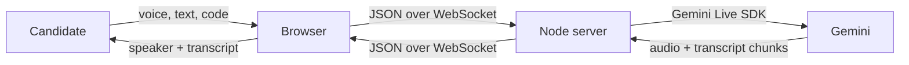

# 00 - Start here

This guide teaches the project in dependency order. Later sections assume the concepts and files introduced earlier.

## Learning goals

After completing the vault, you should be able to explain and implement:

- why a backend is required even though most UI logic lives in the browser;
- how one HTTP server also accepts WebSocket upgrades;
- how PCM microphone samples become JSON-safe Base64;
- how Gemini Live returns streamed PCM audio and partial transcription;
- how streamed text chunks are assembled into readable transcript lines;
- how the main interview and coding-only page share one backend protocol;
- which parts are demo-quality and which parts must change for production.

## How to read the code examples

Examples labeled **minimal version** show the smallest useful implementation. Examples labeled **current-project behavior** explain what the repository currently does. This distinction matters: teaching code is sometimes intentionally smaller than production code.

File names such as `server.ts` refer to files at the repository root unless a path begins with `public/`.

## The simplest mental model

The server is a trusted bridge. The browser never receives the Gemini key. The server translates browser messages into SDK calls and translates Gemini events into browser messages.

## Two user experiences

### Main interview page: `/`

- Enter an interview target such as “Backend Engineer L4.”
- Start a live voice interview.
- Optionally answer by typing.
- Optionally enable a local camera preview.
- Open an embedded code textarea when Gemini emits control tokens.

### Coding-only page: `/coding`

- Choose a language and topic.
- Receive a coding problem with audio and transcription.
- Write code in CodeMirror.
- Keep drafts local until explicitly requesting review.
- Request review by button, keyboard shortcut, or a voice trigger phrase.

## Terminology used in the vault

- **HTTP** serves the initial HTML document.
- **WebSocket** keeps one full-duplex browser/server connection open.
- **Gemini Live session** is the server/Google streaming connection.
- **PCM16** means signed 16-bit pulse-code modulation samples.
- **Base64** is a text encoding used to put binary audio inside JSON.
- **turn** is one completed user or model contribution.
- **chunk** is one partial piece of streamed audio or text.

## Before editing

Read [[01_Project_Scope/01 Project Scope|Project Scope]] and [[03_Project_Structure/03 Project Structure|Project Structure]]. They prevent two common mistakes: exposing the API key in browser code and accidentally developing against the unused legacy `server.js`.

Next: [[01_Project_Scope/01 Project Scope|01 - Project Scope]].

