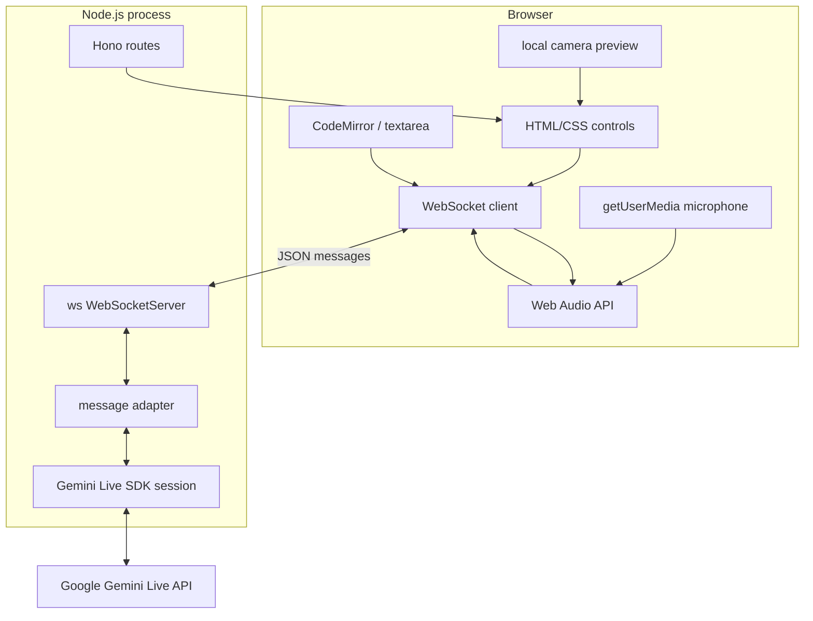
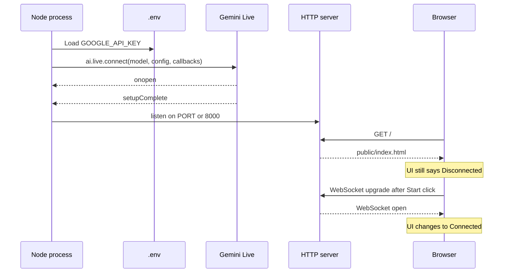
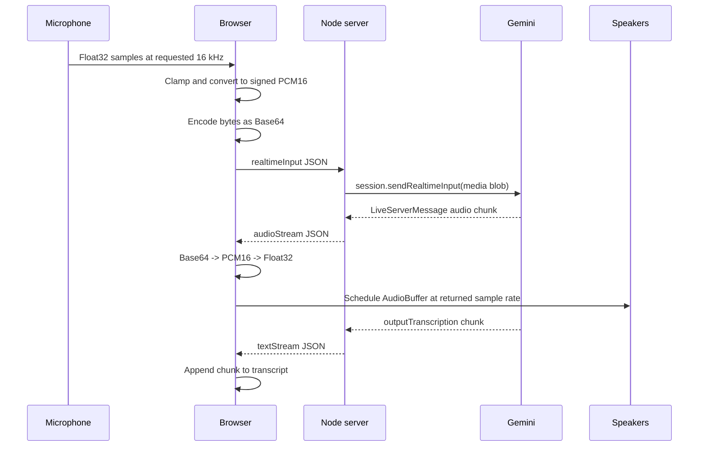

# 04 - System architecture

## Components



The camera currently stays local. Only microphone audio, text, code, language, topic, and control messages travel through the socket.

## Startup sequence



In the current code, an API failure can prevent the HTTP server from starting because Gemini is connected before `serve(...)` is called. A more resilient design starts HTTP first, reports AI availability separately, and creates a Gemini session per browser connection.

## Voice turn data flow



## Text turn data flow

The browser sends:

```json
{
  "type": "contentUpdateText",
  "text": "I would use a hash map."
}
```

The server calls `session.sendClientContent` with one user turn and `turnComplete: true`. “Turn complete” tells the model it may respond now. This differs from live audio, which is sent as an ongoing realtime stream.

## State ownership

| State | Owner | Examples |
|---|---|---|
| API credential | Server process | `GOOGLE_API_KEY` |
| Gemini conversation | Currently global server session | system instruction, prior turns |
| Connection state | Browser and server socket | open, closing, closed |
| Microphone/camera streams | Browser | `MediaStream`, audio nodes |
| UI mode | Browser | interview started, coding panel open |
| Code draft | Browser | CodeMirror contents |
| Last reviewed code | Browser and server hints | duplicate/follow-up logic |

## Important architectural limitations

### Global session

All connected browser sockets are stored in a `Set`, and Gemini output is broadcast to every open socket. This is acceptable only for a single-user demo. Multi-user production code needs a mapping:

```ts
const sessions = new Map<WebSocket, LiveSession>();
```

Each socket should receive output only from its own session.

### No protocol validation

The server parses arbitrary JSON and trusts fields after light string conversion. Production code should validate message shape and size, reject unknown types, and rate-limit audio chunks.

### Browser APIs are capability-dependent

- Microphone and camera require permission.
- Secure contexts are required outside localhost.
- Web Speech recognition is not consistently supported across browsers.
- Audio playback can be suspended until a user gesture.

### Backpressure is not explicit

Audio chunks are sent whenever `onaudioprocess` fires. The code does not inspect `ws.bufferedAmount`. A slow network could accumulate memory. Production code should pause or drop according to a defined threshold.

Next: [[05_Backend_Foundation/05 Backend Foundation|05 - Backend Foundation]].

