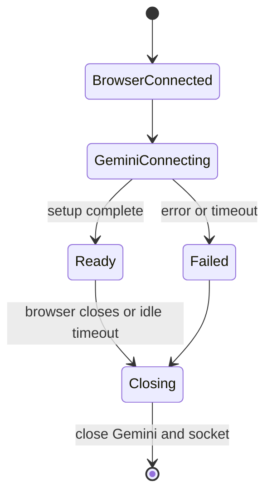

# 06 - Gemini Live integration

## Create the SDK client

```ts
const ai = new GoogleGenAI({
  vertexai: false,
  apiKey: GOOGLE_API_KEY,
});
```

`vertexai: false` selects the Gemini Developer API path rather than Vertex AI. The key remains in Node memory and never appears in page source.

## Select the model

The active code sets a native-audio Gemini 2.5 Flash model string. Live model identifiers are service-controlled and can change. Keep the identifier in one constant or environment variable:

```ts
const LIVE_MODEL = process.env.GEMINI_LIVE_MODEL
  ?? 'your-supported-live-model';
```

Do not assume `test-connection.js` is authoritative: its preview-model string currently differs from `server.ts`.

## Build the system instruction

The project creates an array of short rules and joins them:

```ts
const interviewSystemPrompt = [
  'You are a strict interviewer.',
  'Begin with a brief welcome and warm-up.',
  'Ask exactly one question at a time.',
  'Challenge weak answers and request specifics.',
  'Use [[OPEN_EDITOR]] and [[CLOSE_EDITOR]] only for main-page coding rounds.',
].join(' ');
```

This style is easier to edit than one very long string. The prompt establishes persona, turn-taking, coding controls, and output length. It is guidance, not a security boundary: browser and server logic must still validate actual behavior.

### Why “exactly one question” is repeated

Voice models can naturally continue with several questions. Explicit wait instructions make the result resemble a real dialogue and reduce overlapping candidate/model speech.

### Why control tokens are unusual

`[[OPEN_EDITOR]]` and `[[CLOSE_EDITOR]]` form a lightweight UI-control protocol embedded in transcription. This is easy to demo but brittle. A production design should use structured tool calls or dedicated server messages instead of parsing natural language.

## Configure the Live session

```ts
const config: types.LiveConnectConfig = {
  responseModalities: [Modality.AUDIO],
  outputAudioTranscription: {},
  speechConfig: {
    voiceConfig: {
      prebuiltVoiceConfig: {
        voiceName: 'Aoede',
      },
    },
  },
  systemInstruction: interviewSystemPrompt,
};
```

Field explanation:

- `responseModalities: [AUDIO]` asks for spoken model responses.
- `outputAudioTranscription: {}` asks the service to transcribe its generated speech.
- `speechConfig.voiceConfig` chooses a prebuilt voice.
- `systemInstruction` sets behavior for the session.

The transcript is model-output transcription. The current app does not request or render a separate input transcription of everything the candidate says.

## Connect and register callbacks

```ts
const session = await ai.live.connect({
  model: LIVE_MODEL,
  config,
  callbacks: {
    onopen: () => console.log('Live session open'),
    onmessage: (message) => handleGeminiMessage(message),
    onerror: (event) => console.error('Live session error', event),
    onclose: (event) => console.log('Live session closed', event.code),
  },
});
```

- `onopen` means the transport opened.
- a later `setupComplete` message means server-side session setup completed.
- `onmessage` can fire many times for one spoken response.
- `onerror` reports transport/session problems.
- `onclose` reports closure code, reason, and cleanliness.

## Handle output transcription

```ts
const transcription = message.serverContent?.outputTranscription?.text;
if (transcription) {
  broadcast({ type: 'textStream', data: transcription });
}
```

Optional chaining protects against messages that do not contain server content or transcription. The browser treats `data` as a partial chunk, not necessarily a complete sentence.

## Handle audio

```ts
const parts = message.serverContent?.modelTurn?.parts ?? [];
for (const part of parts) {
  if (part.inlineData?.data) {
    broadcast({
      type: 'audioStream',
      data: part.inlineData.data,
      mimeType: part.inlineData.mimeType,
    });
  }
}
```

The server forwards Base64 and MIME metadata without transcoding. This minimizes CPU work and preserves the sample rate declared by Gemini.

## Send a completed text turn

```ts
session.sendClientContent({
  turns: [{
    role: 'user',
    parts: [{ text: message.text }],
  }],
  turnComplete: true,
});
```

Use this for target selection, typed answers, coding instructions, and code-review requests. `turnComplete: true` asks Gemini to process/respond.

## Send realtime microphone audio

```ts
session.sendRealtimeInput({
  media: createBlob(message.audioData),
});
```

Realtime audio is not wrapped in a completed text turn. Chunks arrive continuously while recording.

## Start prompts

The general page sends a target-specific prompt:

```text
Interview target: Backend Engineer L4. Start with a short welcome and one basic warm-up question. After warm-up, transition to strict interview mode.
```

The coding page sends language, topic, formatting constraints, and an instruction to wait for code. Plain-text constraints help the spoken output and transcript avoid awkward Markdown/LaTeX.

## Session lifecycle improvement

The recommended production flow is:



This flow belongs per browser socket, not globally. Queue or reject user messages until the session reaches `Ready`.

Next: [[07_WebSocket_Protocol/07 WebSocket Protocol|07 - WebSocket Protocol]].

