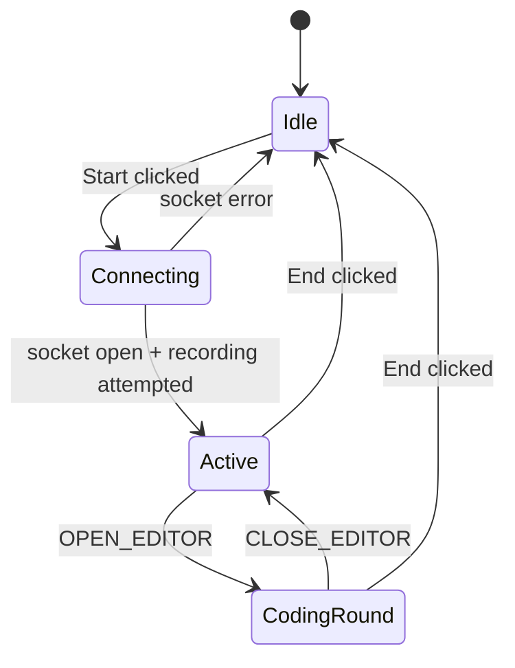

# 08 - Main interview UI

The main page is `public/index.html`. It deliberately uses one HTML file containing markup, CSS, and JavaScript.

## Visual regions

The body is organized into:

1. top bar with title and connection status;
2. participant stage with Gemini and candidate cards;
3. session-control panel;
4. optional embedded coding panel;
5. transcript panel.

Important DOM IDs include:

| ID | Purpose |
|---|---|
| `connection-status`, `status-text` | Connected/disconnected indicator |
| `gemini-card`, `user-card` | Speaking visual states |
| `user-video`, `user-fallback` | Camera preview or fallback avatar |
| `interview-target-input` | Role/company/level prompt |
| `startBtn`, `stopBtn`, `cameraBtn` | Session controls |
| `text-form`, `text-input` | Typed-answer path |
| `coding-panel`, `code-editor` | Embedded coding round |
| `transcript` | Streaming conversation log |

Using stable IDs makes direct `document.getElementById` lookup simple. In a modular frontend, these nodes would be passed into components rather than stored as many globals.

## Browser state

```js
let ws = null;
let audioContext = null;
let microphone = null;
let processor = null;
let isRecording = false;
let interviewStarted = false;
let interviewTarget = '';
```

Additional state tracks queued output audio, camera media, the current streaming transcript line, control-token buffering, and duplicate code submissions.

The variables form an implicit state machine. For maintainability, document allowed transitions:



## Connection indicator

```js
function setConnectionStatus(connected) {
  statusText.textContent = connected ? 'Connected' : 'Disconnected';
  statusPill.classList.toggle('connected', connected);
  geminiStatus.innerHTML = connected
    ? '<span></span>Ready'
    : '<span></span>Offline';
}
```

The initial label is **Disconnected** because no browser WebSocket exists yet. `connectWebSocket()` runs inside the Start button handler, not on page load.

## Speaking indicators

- Gemini is marked speaking while scheduled audio buffer sources remain active.
- The candidate is marked speaking when the microphone chunk’s RMS amplitude exceeds `0.02`.
- A 250 ms timer prevents the candidate indicator from flickering between adjacent chunks.

RMS calculation:

```js
const rms = Math.sqrt(
  inputData.reduce((sum, value) => sum + value * value, 0)
  / inputData.length
);
```

RMS measures signal energy, not semantic speech. Background noise can trigger it, and a quiet speaker may stay below the threshold.

## Safe transcript rendering

`appendTranscriptLine` creates nodes and assigns text with `textContent` rather than `innerHTML`:

```js
const textNode = document.createElement('span');
textNode.textContent = text;
```

This is an important XSS defense because model and user text is untrusted.

## Joining streamed chunks

`appendGeminiText` reuses one active transcript text node. It conditionally inserts a space when two alphanumeric chunks would otherwise merge. A 900 ms inactivity timer sets `geminiLine = null`, so the next chunk begins a new visible line.

This is heuristic because the protocol does not send an explicit “transcription turn finished” browser message. A better backend would forward a turn-complete event.

## Coding control tokens

`sanitizeGeminiChunk` maintains a rolling `controlBuffer` so a token split across network chunks can still be detected. It:

1. appends the new chunk;
2. keeps only the last 300 characters;
3. detects open/close tokens;
4. calls `openCodingRound` or `closeCodingRound`;
5. removes tokens before rendering.

Phrase matching acts as a fallback. It can produce false positives because normal speech is being used as a control channel.

## Camera behavior

```js
cameraStream = await navigator.mediaDevices.getUserMedia({
  video: true,
  audio: false,
});
userVideo.srcObject = cameraStream;
```

The camera is only a local preview. No frame is sent over WebSocket or to Gemini. When disabled, each track is stopped so the hardware/privacy indicator turns off.

## Typed answers

The form handler prevents page navigation, checks that an interview is active, sends `contentUpdateText`, and immediately renders the candidate’s local line. Immediate local rendering avoids waiting for a server echo.

## Starting the session

The Start click sequence is:

1. validate target;
2. `await connectWebSocket()`;
3. send `startInterview`;
4. render a system line;
5. `await startRecording()`;
6. enable/disable the correct controls.

One subtle issue: `startRecording()` catches its own microphone error and does not rethrow. The outer code still sets `interviewStarted = true`, enabling text-only use. This may be intentional, but the UI should explicitly say it is continuing without microphone.

## Ending and reset

The End handler stops audio capture, closes the socket, and calls `resetSessionState`. Camera cleanup is separate, so decide whether ending an interview should also disable the camera.

Next: [[09_Real_Time_Audio/09 Real-Time Audio|09 - Real-Time Audio]].

